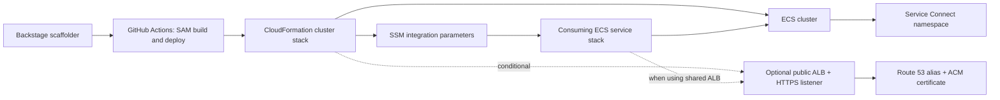
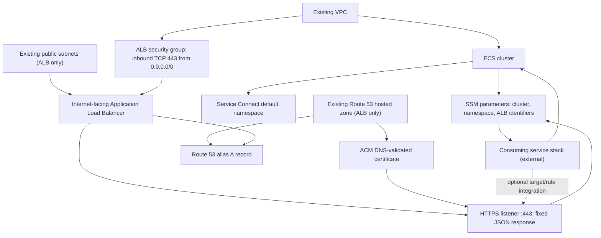
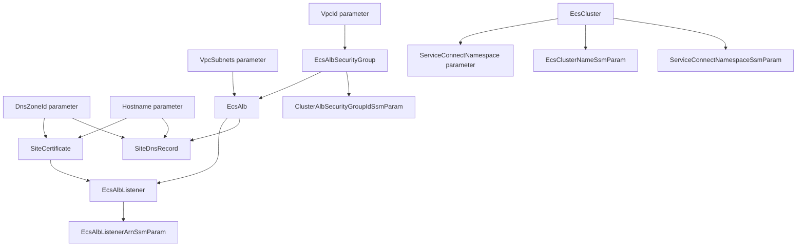

# Architecture

## Logical architecture

The cluster stack provides shared ECS and networking integration points:

- The ECS cluster is configured with Service Connect defaults.
- A conditional internet-facing ALB provides an HTTPS listener and a DNS
  endpoint, but the starter listener returns a fixed response rather than
  forwarding to an application.
- SSM parameters publish the cluster name, Service Connect namespace, and
  (when enabled) ALB listener and security group identifiers.
- Consuming application stacks create services, tasks, capacity, target groups,
  and routing rules as needed.

#### Logical architecture diagram



The ALB listener has a fixed-response default action and no target group or
application route in this template. A service stack must configure its own
target registration and routing rules before the ALB can serve application
traffic.

## Physical architecture



The VPC, subnet list, and hosted zone are external prerequisites. When the load
balancer is disabled, the unconditional ALB security-group SSM parameter
currently references the conditionally omitted security group; that template
path must be fixed before use.

## CloudFormation template

`template.yaml` is the infrastructure-as-code entry point. The
`Transform: AWS::Serverless-2016-10-31` enables AWS SAM and CloudFormation
expands the template during deployment.

| Section/resource | Purpose |
| --- | --- |
| `Parameters` | Supplies organizational identifiers, branch slug, VPC, Service Connect namespace, and conditional ALB/DNS values. |
| `EcsAlbSecurityGroup` | Allows inbound TCP 443 from any IPv4 address; created only when the ALB option is enabled. |
| `SiteCertificate`, `EcsAlb`, `EcsAlbListener`, `SiteDnsRecord` | Conditional ACM, ALB, listener, and DNS resources. |
| `EcsCluster` | Creates the cluster and its Service Connect defaults. |
| `EcsClusterNameSsmParam`, `ServiceConnectNamespaceSsmParam` | Publish shared cluster integration values. |
| `ClusterAlbSecurityGroupIdSsmParam`, `EcsAlbListenerArnSsmParam` | Publish ALB integration values; the listener parameter is conditional, but the security-group parameter is currently unconditional. |

#### Template resource relationships



All ALB resources are conditional except `ClusterAlbSecurityGroupIdSsmParam`;
that inconsistency explains why the no-ALB rendering is invalid.

## Generated repository layout

```text
catalog-info.yaml              Backstage Component entity
README.md                       Generated component summary
template.yaml                   SAM/CloudFormation cluster infrastructure
cfn-parameters.json             Deployment-action parameter expressions
cfn-tags.json                   Deployment-action tag expressions
samconfig.toml                  SAM stack and build defaults
docs/handbook/                  This handbook
.github/workflows/main.yml      Main-branch build and deployment workflow
```

The cluster repository has no application source code or tests. ECS services
and their application artifacts are managed by separate consuming components.
