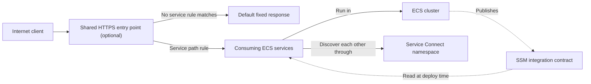
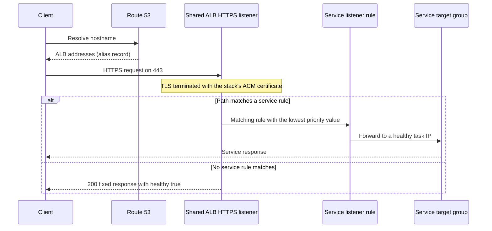
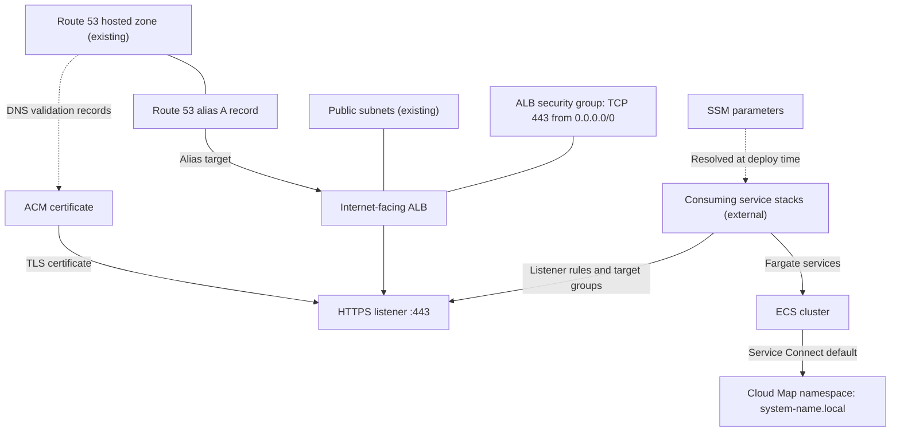
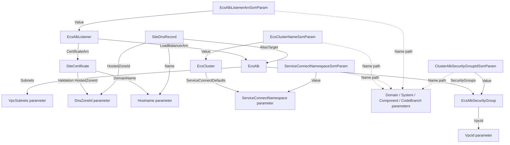

# Architecture

## Infrastructure

### Logical architecture

The cluster is shared platform infrastructure. It separates the public entry
point, workload placement, and service discovery, and it publishes an
integration contract for the services that run in it:

- The ECS cluster is the placement boundary for services. It owns no compute
  capacity; consuming services run on Fargate.
- The cluster's Service Connect namespace gives services in the system a
  private discovery domain.
- An optional shared, internet-facing ALB terminates TLS for one hostname.
  Each consuming service attaches its own listener rule and target group.
- SSM parameters publish the identifiers consumers need, so service stacks never
  hard-code generated names or ARNs.

#### Logical architecture diagram



#### Request routing call sequence

The listener evaluates rules added by consuming services in ascending priority
order and falls back to the cluster's default action.



The fixed response is the listener's default action. It does not indicate that
any service is running or healthy.

### Physical architecture



`template.yaml` owns the cluster, SSM parameters, and the optional ALB, its
security group, listener, certificate, and DNS record. The VPC, subnets, hosted
zone, the `/org/...` SSM parameters, and CI roles are external dependencies.
The ALB, listener, certificate, DNS record, and their security group are
omitted when the ALB is disabled.

### CloudFormation template

`template.yaml` is the infrastructure-as-code entry point. Its
`Transform: AWS::Serverless-2016-10-31` enables AWS SAM processing; the
resources themselves are standard CloudFormation ECS, EC2, Elastic Load
Balancing, ACM, Route 53, and SSM types. Backstage renders the template's Nunjucks conditional
blocks at creation time, so the generated file contains only the resources
for the selected option rather than CloudFormation `Conditions`.

| Section/resource | Purpose |
| --- | --- |
| `Parameters` | Domain/system/component metadata, branch slug, VPC, Service Connect namespace, and, with the ALB, subnets, hostname, and hosted zone. |
| `EcsCluster` | The cluster and its Service Connect default namespace. |
| `EcsAlbSecurityGroup`, `EcsAlb`, `EcsAlbListener` | Shared ALB, its public ingress, and the HTTPS listener with a fixed-response default action. |
| `SiteCertificate`, `SiteDnsRecord` | DNS-validated certificate and alias record for the hostname. |
| `EcsClusterNameSsmParam`, `ServiceConnectNamespaceSsmParam` | Always-published integration values. |
| `EcsAlbListenerArnSsmParam` | Listener ARN; rendered with the ALB. |
| `ClusterAlbSecurityGroupIdSsmParam` | ALB security-group ID; currently rendered unconditionally. |

#### Template resource relationships

Arrows run from the referencing resource to its target; they show
infrastructure references, not request flow.



`SgSsm → SG` is the reference that breaks the ALB-disabled rendering.
`cfn-parameters.json` and `cfn-tags.json` provide deployment-action inputs,
while `samconfig.toml` supplies SAM defaults. Validate changes with
`sam validate --lint` and `sam build` before deployment.

## Repository file layout

```text
catalog-info.yaml          Backstage Component entity
mkdocs.yml                 TechDocs site configuration
docs/handbook/             Handbook pages
README.md                  Project entry point
template.yaml              SAM/CloudFormation cluster infrastructure
cfn-parameters.json        Deployment-action parameter expressions
cfn-tags.json              Deployment-action tag expressions
samconfig.toml             SAM build, validation, and deploy defaults
.github/workflows/main.yml Main-branch build and deployment workflow
```

These are generated-project paths. The template source repository keeps their
inputs under `cluster/skeleton/` and `cluster/pipeline/` before the scaffolder
combines them. The cluster repository has no application source code or tests;
services and their images live in separate consuming components.
