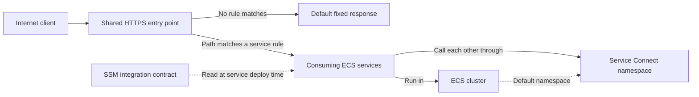
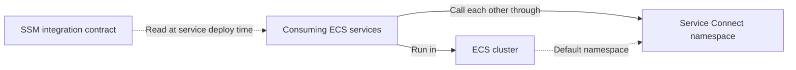
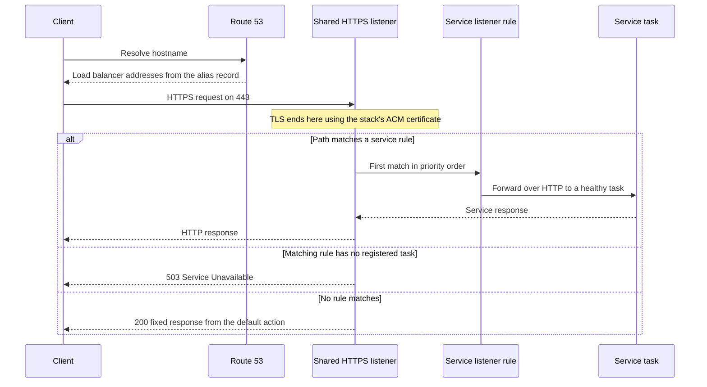
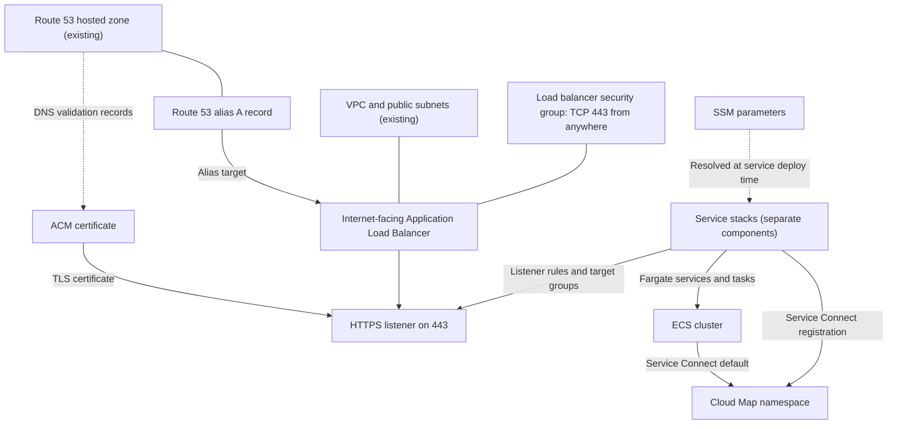
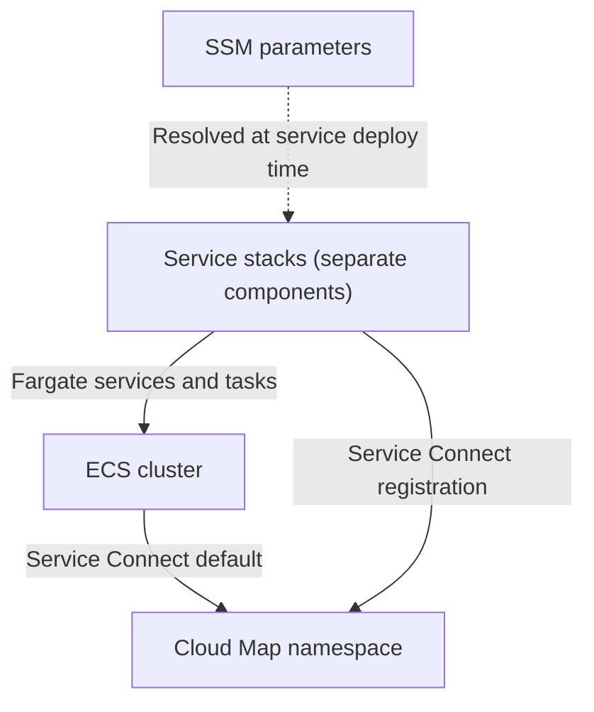
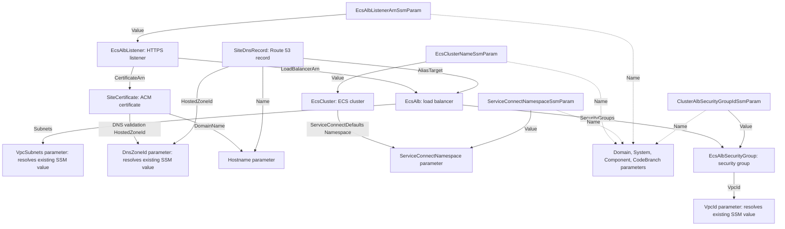
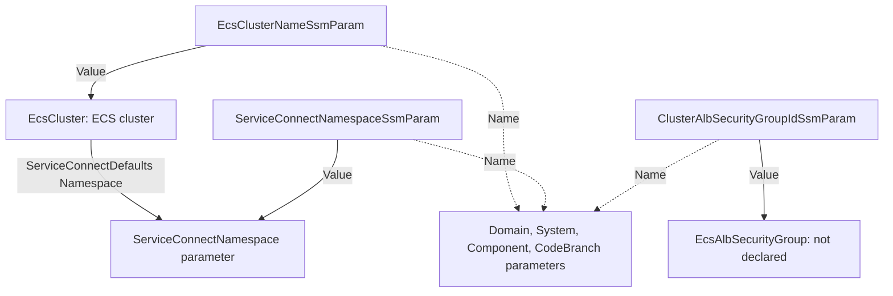

# Architecture

## Infrastructure

### Logical architecture

The cluster is shared infrastructure for the services of one system. It
separates workload placement, private service discovery, and the public entry
point, and publishes what services need to attach to each:

- The ECS cluster is the placement boundary. It owns no compute capacity;
  services run their tasks on Fargate.
- The Service Connect namespace gives services a private discovery domain, so
  they call each other by name.

- The shared load balancer is the single public HTTPS entry point. It
  terminates TLS for one hostname; each service attaches a path-based rule.

- There is no public entry point. Services are reachable only from other
  services through Service Connect.

- The SSM integration contract publishes the generated identifiers, so service
  stacks resolve them at deploy time and never hard-code names or ARNs.

Services, their tasks, images, security groups, and logs belong to the
consuming service components, not to this cluster.

#### Logical architecture diagram







#### Service attachment call sequence

A service stack attaches to the cluster when it deploys. Nothing in the
cluster stack changes; the service only reads the published values.

```mermaid
sequenceDiagram
    participant Pipeline as Service deployment
    participant CFN as CloudFormation
    participant SSM as SSM Parameter Store
    participant ECS as ECS cluster

    participant ALB as Shared listener


    Pipeline->>CFN: Deploy service stack with SSM parameter names
    CFN->>SSM: Resolve names under the cluster's main path
    alt A parameter is missing
        SSM-->>CFN: Parameter not found
        CFN-->>Pipeline: Deployment fails before any resource changes
    else All parameters resolve
        SSM-->>CFN: Cluster name, namespace, and any load balancer values
        CFN->>ECS: Create service in the cluster and register in the namespace

        opt Service uses the cluster load balancer
            CFN->>ALB: Add listener rule and target group
            Note over CFN,ALB: Fails if the rule priority is already used
        end

        CFN-->>Pipeline: Service stack complete
    end
```

Parameters are resolved when a service stack deploys, not continuously. A
changed value reaches a service only on that service's next deployment.


#### Request routing call sequence

The listener evaluates the rules added by services in ascending priority order
and falls back to the cluster's default action.



The fixed response is the listener's default action. It does not indicate that
any service is running or healthy. Traffic between the load balancer and tasks
is unencrypted HTTP inside the VPC.


### Physical architecture




`template.yaml` owns the cluster, SSM parameters, load balancer, security
group, listener, certificate, and DNS record. The VPC, subnets, hosted zone,
`/org/...` SSM parameters, and CI roles are external dependencies. Listener
rules, target groups, services, and tasks are owned by the service stacks.



`template.yaml` owns the cluster and SSM parameters. The VPC, the
`/org/networking/VpcId` SSM parameter, and CI roles are external dependencies.
Services and tasks are owned by the service stacks.


The Cloud Map namespace is named `${{ values.system_name }}.local`. The SSM
parameter names are listed in
[Features](01-features.md#ssm-integration-contract).

### CloudFormation template

`template.yaml` is the infrastructure-as-code entry point. Its
`Transform: AWS::Serverless-2016-10-31` lets the SAM CLI validate, build, and
deploy it, but it declares no SAM resource types: every resource is a standard
CloudFormation type. The template has no `Conditions` or `Outputs`; other
stacks consume it only through SSM parameters.

| Section | Purpose |
| --- | --- |

| `Parameters` | Supplies domain/system/component metadata, the deployed ref, the Service Connect namespace, the hostname, and SSM parameter names for the VPC, subnets, and hosted zone. |
| `Resources` | Declares the cluster, load balancer, security group, listener, certificate, DNS record, and four SSM parameters. |

| `Parameters` | Supplies domain/system/component metadata, the deployed ref, the Service Connect namespace, and the SSM parameter name for the VPC. |
| `Resources` | Declares the cluster and its SSM parameters. |


`Ref` and `GetAtt` connect resources without hard-coding generated names or
ARNs, and the SSM parameter names are built from the metadata parameters with
`Sub`.

#### Template resource relationships

Arrows below run from the referencing resource/configuration to its target;
they show infrastructure references, not request flow.




Replacing the cluster, listener, or security group changes the value of the
matching SSM parameter. Services keep using the old value until they redeploy,
and a replaced listener loses every service's rule.



`ClusterAlbSecurityGroupIdSsmParam` references a resource this template does
not declare, which is why validation fails as generated. Remove it as described
in [Common tasks](07-common-tasks.md#make-the-template-deployable). The `VpcId`
parameter is declared but no resource references it.


`cfn-parameters.json` and `cfn-tags.json` provide deployment-action inputs,
while `samconfig.toml` supplies SAM deployment defaults. See
[Configuration](03-configuration.md) for their expression syntax and external
prerequisites. Validate changes with `sam validate --lint` before deployment.

## Software

### Repository file layout

```text
catalog-info.yaml       Backstage Component entity
mkdocs.yml              TechDocs site configuration
docs/handbook/          Handbook pages
README.md               Project entry point
template.yaml           SAM/CloudFormation cluster infrastructure
cfn-parameters.json     Deployment-action parameter expressions
cfn-tags.json           Deployment-action tag expressions
samconfig.toml          SAM validate and deploy defaults
.github/workflows/      main.yml
```

These are generated-project paths. The template source repository keeps their
inputs separately under `cluster/skeleton/` and `cluster/pipeline/` before the
scaffolder combines them.

The repository contains no application code, container image, or tests. The
software that runs in the cluster lives in the service components that depend
on it; find them through this component's dependents in the catalog.
