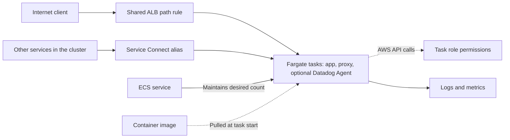
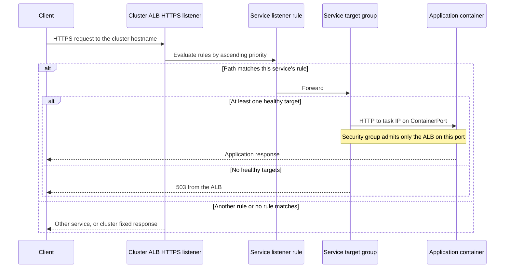
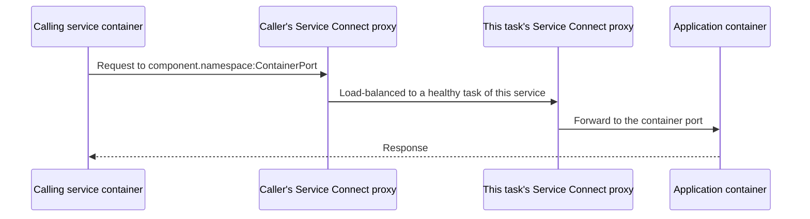
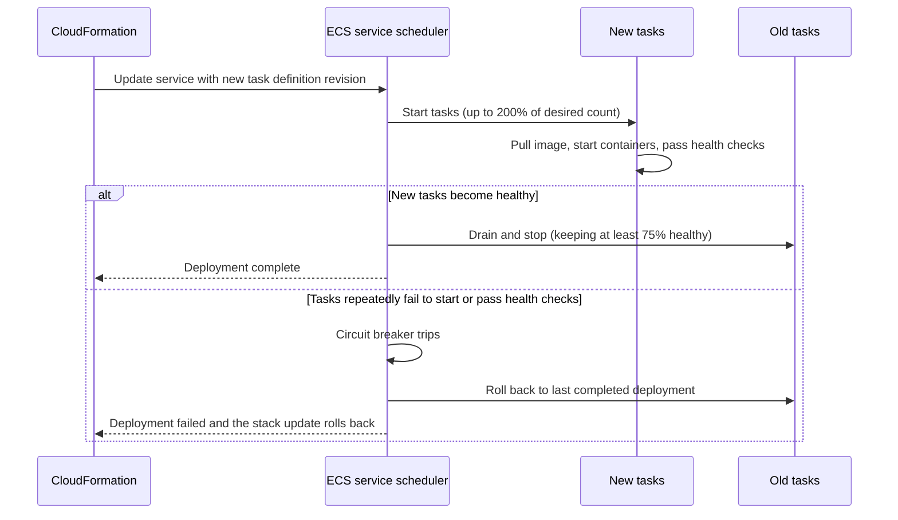
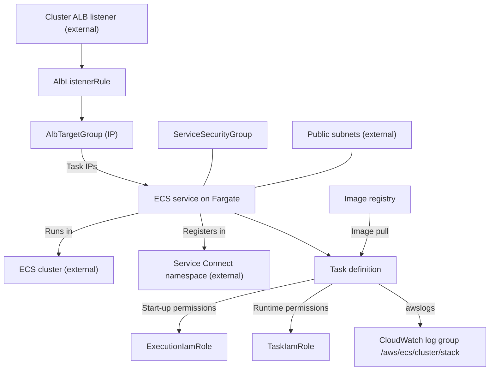
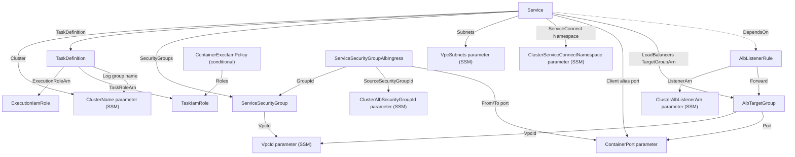

# Architecture

## Infrastructure

### Logical architecture

The service separates its public entry, private discovery, runtime, and
permissions:

- Public traffic enters through the cluster's shared ALB; a path-based listener
  rule selects this service. The service owns no hostname or certificate.
- Service Connect gives other services in the cluster a private name for this
  service.
- An ECS service keeps the desired number of Fargate tasks running and replaces
  unhealthy ones; deployments roll back automatically when they fail.
- Each task runs the application container, an ECS-managed Service Connect
  proxy, and optionally a Datadog Agent sidecar.
- Two IAM roles separate what ECS needs to start the task from what the
  application may do at runtime.
- Cluster identifiers are resolved from SSM at deploy time, not hard-coded.

#### Logical architecture diagram



#### Public request call sequence



The ALB terminates TLS; traffic from the ALB to the task is plain HTTP inside
the VPC. The request path is passed unchanged.

#### Service-to-service call sequence



Only services that also enable Service Connect in the same namespace can
resolve the alias. Service Connect traffic still needs the receiving security
group to admit it; the starter security group only admits the ALB, so add
ingress from calling services' security groups. See
[Common tasks](07-common-tasks.md#call-or-expose-a-service-through-service-connect).

#### Deployment rollout sequence



### Physical architecture



`template.yaml` owns the task definition, service, both IAM roles, the optional
ECS Exec policy, the service security group, and, with the load balancer, the
target group, listener rule, and ALB ingress rule. The cluster, namespace, ALB
and listener, VPC and subnets, image registry, `/org/...` and cluster SSM
parameters, and CI roles are external dependencies. The log group is created
by the `awslogs` driver at first use, not by CloudFormation.

### CloudFormation template

`template.yaml` is the infrastructure-as-code entry point. Its
`Transform: AWS::Serverless-2016-10-31` enables AWS SAM processing; the
resources are standard CloudFormation ECS, EC2, IAM, and Elastic Load Balancing
types. Backstage renders the template's Nunjucks conditional blocks at
creation time, so load-balancer, Datadog, and development-variant pieces are
either present or absent in the generated file. ECS Exec is the only
CloudFormation `Condition`.

| Section/resource | Purpose |
| --- | --- |
| `Parameters` | Catalog metadata, branch, cluster SSM references, image, sizing, ECS Exec, and optional load-balancer, port, and Datadog values. |
| `Conditions.IsEnableContainerExec` | Creates `ContainerExecIamPolicy` only when ECS Exec is enabled. |
| `TaskDefinition` | Fargate task, application container, optional Datadog sidecar, roles, labels, and logging. |
| `Service` | Desired count, networking, deployment settings, Service Connect, and optional target-group registration. |
| `ExecutionIamRole`, `TaskIamRole`, `ContainerExecIamPolicy` | Start-up permissions, runtime permissions, and optional ECS Exec permissions. |
| `ServiceSecurityGroup`, `ServiceSecurityGroupAlbIngress` | Task network boundary and ALB-only ingress. |
| `AlbTargetGroup`, `AlbListenerRule` | Target group and path rule on the cluster listener. |

#### Template resource relationships

Arrows run from the referencing resource to its target; they show
infrastructure references, not request flow.



`SG → VpcId` and `Service → Port` are the references that break the
load-balancer-disabled rendering, because those parameters are only declared
with the load balancer. `cfn-parameters.json` and `cfn-tags.json` provide
deployment-action inputs, while `samconfig.toml` supplies SAM defaults.

### IAM roles

| Role | Assumed by | Starter permissions | Add here |
| --- | --- | --- | --- |
| `ExecutionIamRole` | ECS agent, while starting tasks | ECR image pull; CloudWatch Logs create and write | Reading values for `Secrets` (Secrets Manager or SSM) and private-registry credentials |
| `TaskIamRole` | Application code at runtime | None; plus SSM Messages channels when ECS Exec is enabled | Everything the application calls: S3, DynamoDB, SQS, and so on |

Both roles trust `ecs-tasks.amazonaws.com` and use `Resource: '*'` for their
starter actions. Scope new permissions to specific resources. Never widen the
execution role to give the application access.

## Software

### Repository file layout

```text
catalog-info.yaml                  Backstage Component entity
mkdocs.yml                         TechDocs site configuration
docs/handbook/                     Handbook pages
README.md                          Project entry point
template.yaml                      ECS service infrastructure
cfn-parameters.json                Deployment-action parameter expressions
cfn-tags.json                      Deployment-action tag expressions
samconfig.toml                     SAM build, validation, and deploy defaults
.github/workflows/main.yml         Build and deploy on main
.github/workflows/branch.yml       Build only on other branches
.github/workflows/ecr-policy.json  ECR repository policy for built images
src/                               Development variant only: application and Dockerfile
```

These are generated-project paths. The template source repository keeps their
inputs under `container/skeleton/`, `container/pipeline/`, and
`container/nodejs_app/` before the scaffolder combines them. The image-based
variant also receives `ecr-policy.json`, but uses it only if you add an image
build.

### Anatomy of the task definition

| Container | Image | Purpose |
| --- | --- | --- |
| `<component>` | Image-based: `<ContainerImage>:<ContainerTag>`. Development: `<ContainerRepo>/<ContainerOrg>/<ContainerImage>:<ContainerTag>`. | The application. One named port mapping on `ContainerPort`, Docker labels, and `awslogs` with stream prefix `app`. |
| `datadog-agent` | `public.ecr.aws/datadog/agent:latest` | Optional. 256 CPU / 512 MB; `DD_API_KEY`, `DD_SITE`, `ECS_FARGATE`, `DD_LOG_LEVEL`; `agent health` check; stream prefix `sidecar`. |
| Service Connect proxy | Managed by ECS | Added to each task by ECS, not declared in `template.yaml`. Logs to the same group with stream prefix `sidecar`. |

The application container's Docker labels
`com.datadoghq.tags.domain`, `.system`, `.component`, and `.code_branch` give
Datadog unified tags. The container is essential by default, so if it exits,
ECS stops and replaces the task. The commented `Environment`, `Secrets`, and
`HealthCheck` blocks show where to add runtime configuration.

### Anatomy of the Node.js starter

The Node.js development application generates a deliberately minimal `src/`:

| File | Purpose |
| --- | --- |
| `package.json` | Package metadata, `engines.node: lts/iron` (Node.js 20, used by CI to select a version), Yarn 4.4.1, scripts, and TypeScript/ESLint/Jest dev dependencies. No runtime dependencies. |
| `tsconfig.json` | Extends `@tsconfig/node20`; compiles `src/src/` to `src/dist/`. |
| `.yarnrc.yml` | Uses the `node-modules` linker. |
| `Dockerfile` | Only `FROM node:20-alpine`. It copies no code and defines no command. |

There is no application source, test, or ESLint configuration yet. The CI
compile, test, and lint steps need them, and the image needs a `COPY`, a build,
and a `CMD` that starts a server on `ContainerPort`. See
[Common tasks](07-common-tasks.md#develop-the-nodejs-starter).

### Networking anatomy

Tasks use `awsvpc` mode, so each task has its own ENI and private IP in one of
the public subnets, plus a public IP. `ServiceSecurityGroup` is attached to every
task ENI; it has no inbound rules except, with the load balancer, the container
port from the cluster ALB security group. Outbound traffic is unrestricted.
The target group registers task IPs directly (`TargetType: ip`).
