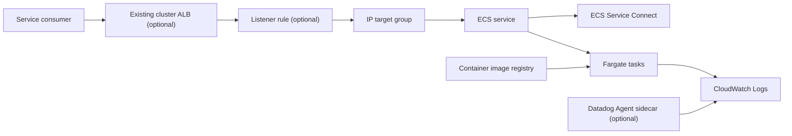
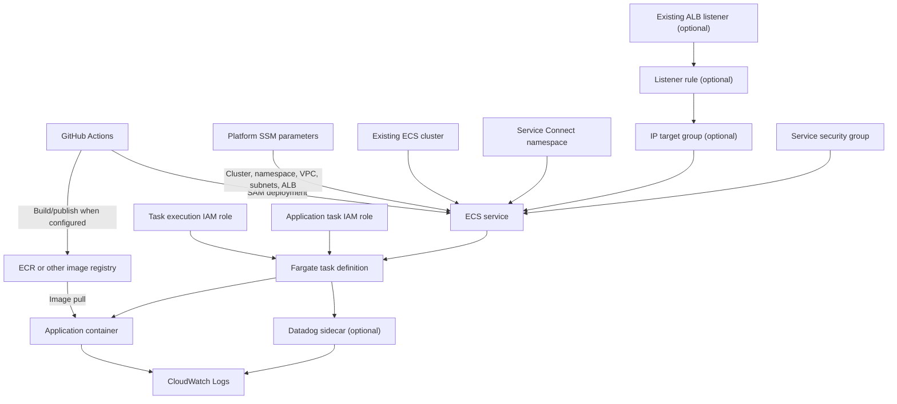

# Architecture

## Infrastructure

### Logical architecture

The service is composed of a containerized application and shared ECS
infrastructure:

- A GitHub Actions workflow builds and publishes a container image when the
  development-container variant is configured to do so.
- A Fargate task definition runs the image with task CPU, memory, execution
  role, task role, networking, port mappings, and log configuration.
- An ECS service maintains the desired task count in an existing cluster and
  registers the service with ECS Service Connect.
- An optional ALB listener rule forwards selected paths to a target group
  whose targets are the service task ENIs.
- CloudWatch receives the application container's `awslogs` output and
  Service Connect logs; Datadog can be added as a sidecar.



The ALB path is conditional, while Service Connect is always enabled. The
Service Connect alias provides cluster service discovery; it is not a public
DNS name. Health checks for an ALB-enabled service use HTTP `/` on the
configured container port.

### Physical architecture



`template.yaml` creates the task definition, ECS service, task execution and
task IAM roles, optional ECS Exec policy, service security group, and optional
ALB target group/listener rule/ingress. The ECS cluster, its Service Connect
namespace, VPC/subnets, load balancer, and image registry are external
dependencies.

### CloudFormation template

`template.yaml` is the infrastructure-as-code entry point. Its
`Transform: AWS::Serverless-2016-10-31` enables SAM/CloudFormation processing;
the resources declared here are standard CloudFormation ECS, EC2, IAM, and
Elastic Load Balancing resources.

| Section | Purpose |
| --- | --- |
| `Parameters` | Receives catalog metadata, branch, existing cluster and networking references, container sizing/image, and optional integrations. |
| `Conditions` | Controls creation of the ECS Exec permissions. |
| `Resources.TaskDefinition` | Defines the Fargate task, application container, optional Datadog sidecar, roles, ports, labels, and logs. |
| `Resources.Service` | Maintains desired tasks, configures networking, Service Connect, deployment rollback, and optional ALB registration. |
| IAM resources | Separate task initialization permissions from permissions granted to the running application. |
| Optional ALB resources | Create target group, listener rule, and ALB-to-task security-group ingress. |

The CloudFormation references connect names, roles, task definition, target
group, listener and security group without hard-coding generated ARNs.
`cfn-parameters.json` and `cfn-tags.json` are inputs to the shared deployment
action; `samconfig.toml` supplies SAM defaults. See
[Configuration](03-configuration.md) for parameter origins and requirements.

### IAM roles

The **task execution role** is used by ECS during task startup. The template
grants ECR image-pull actions and CloudWatch Logs create/write actions. The
**task role** is assumed by application code inside the running task and has
no application policies by default. Add narrowly scoped permissions there
when needed; avoid granting application access by expanding the execution
role.

When ECS Exec is enabled, an additional policy grants the task role SSM
Messages control/data channel actions. Operators still need appropriate
permissions and network access to use ECS Exec.

## Software and repository layout

The standard service skeleton contains infrastructure and workflow
configuration rather than an application implementation:

```text
catalog-info.yaml                Backstage Component metadata
README.md                        Generated component entry point
template.yaml                    ECS/SAM infrastructure
cfn-parameters.json              Deployment-action parameter expressions
cfn-tags.json                    Deployment-action resource tags
samconfig.toml                   SAM build, validation, and deploy defaults
docs/handbook/                   This handbook
.github/workflows/main.yml       Main build and deploy workflow
.github/workflows/branch.yml     Non-main infrastructure build workflow
.github/workflows/ecr-policy.json ECR repository policy for image builds
```

The parent template repository also has `container/nodejs_app/src/`, an
application starter used by the development-container variant. That starter
contains a Node.js/TypeScript package manifest and Dockerfile; it is not part
of every standard image-based service. Confirm which variant generated the
repository before following application-specific instructions.

### Container image and task anatomy

The task definition creates the main container with an image expression of the
form:

```text
<image-repository>:<tag>
```

For the development-image variant, the repository and owner prefix are built
from the ECR repository and GitHub repository metadata. The task definition
may also create a `datadog-agent` sidecar. Container port mappings are
conditional, but Service Connect always references `ContainerPort`; ensure
port configuration is present when rendering the template.

The application container receives Docker labels for domain, system,
component, and code branch. Its `awslogs` stream prefix is `app`; the
Datadog sidecar's prefix is `sidecar`. The task definition includes commented
examples for environment variables, secrets, and container health checks.

### Networking anatomy

Fargate tasks use `awsvpc` mode and the subnet list resolved from
`VpcSubnets`. The service security group is attached to the task ENIs. With an
ALB, an ingress rule permits the selected container port from the ALB security
group, and an IP target group routes to task ENIs. The current template sets
`AssignPublicIp: ENABLED`.

Service Connect is enabled independently of ALB routing and registers the
service name/port in the cluster namespace. See [Features](01-features.md) for
the load-balancer-disabled parameter mismatch that must be resolved before
using that option.
